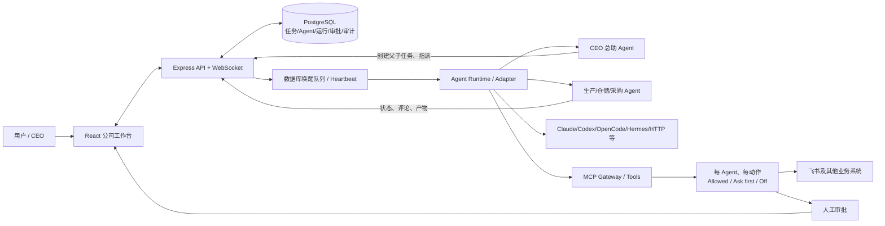
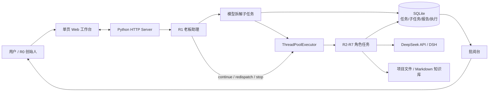
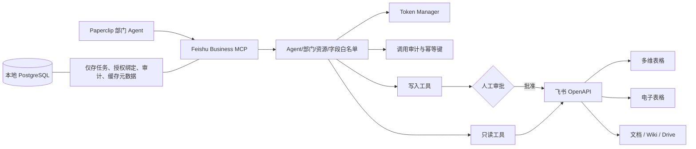

# AI 一人公司多智能体工作台选型报告

> 调研对象：Paperclip、OPC-Web  
> 调研日期：2026-11-10  
> 调研方式：固定到当日默认分支最新提交，检查真实源码、依赖、页面路由、任务调度、存储、审批、工具系统、CI 与公开问题；未安装依赖、未运行未知脚本、未修改上游仓库。

## 结论先行

**推荐以 Paperclip 作为 AI Company OS 的技术底座，以 OPC-Web 作为中文“一人公司”交互与页面设计参考。**

原因不是 Paperclip 的页面更像现成公司，而是它已经具备本项目最难、后期返工成本最高的“控制平面”：独立 Agent、任务层级、运行队列、心跳唤醒、审批、审计、密钥、成本、MCP 工具权限和可插拔运行环境。OPC-Web 更轻、更适合 Windows 快速演示，也更贴近“创始人—总助—员工”的中文心智模型，但其专业分工主要由角色卡和提示词实现，外部工具只有少数硬编码能力，权限、MCP、密钥治理和企业级审计需要大幅补建。

需要同时正视 Paperclip 的缺点：项目体量大、迭代非常快，原生 Windows 的嵌入式 PostgreSQL/本地执行器存在已报告问题；其“CEO 自动拆解”主要由 Agent 指令、模型判断和任务 API 共同实现，不是一个完全确定性的业务流程引擎。建议采用 **Paperclip 控制平面 + 飞书业务 MCP + 自建领域模块 + OPC-Web 式中文工作台**，优先通过插件/MCP 扩展，减少长期维护 Fork 的成本。

---

## 第一部分：两个项目的基本介绍

### 1. Paperclip：AI 员工公司的控制平面

Paperclip 解决的不是“同时开几个聊天窗口”，而是如何像管理公司一样管理一组持续工作的 Agent：建立组织结构、给 Agent 分配职位和预算、创建父子任务、按事件唤醒 Agent、查看运行过程、审批敏感操作、保存任务与审计记录，并让 Agent 连接不同模型、编码环境和外部工具。

源码显示它是一个 TypeScript Monorepo：React 前端、Express 后端、Drizzle ORM、PostgreSQL/内嵌 PostgreSQL，以及独立的 Agent 运行与 MCP 模块。根项目要求 Node.js 24.11+ 与 pnpm 9.15.4。[根依赖与运行要求](https://github.com/paperclipai/paperclip/blob/0c7a628fd1e9d8e52804a8717edd74ec8a5e83ed/package.json)、[服务端依赖](https://github.com/paperclipai/paperclip/blob/0c7a628fd1e9d8e52804a8717edd74ec8a5e83ed/server/package.json)、[前端依赖](https://github.com/paperclipai/paperclip/blob/0c7a628fd1e9d8e52804a8717edd74ec8a5e83ed/ui/package.json)

它更接近本项目所需的“操作系统底座”，但生产、仓储、采购、销售、财务等业务语义并不存在，仍需自行开发。

### 2. OPC-Web：面向个人创业者的轻量 Agent 作战台

OPC-Web 把一个人公司表达为 R0 创始人、R1 老板助理、R2—R7 专业员工。用户把任务交给 R1，R1 通过模型拆成子任务，调度多个角色并行执行，最后进入批阅台，由创始人批准、驳回或修改。它还提供项目文件、知识库、每日简报、任务看板和角色工作区。

源码是轻量 Python 应用：标准库 HTTP 服务、SQLite、Markdown/JSON 文件，以及单页 HTML/CSS/JavaScript 前端；运行依赖极少，项目声明支持 Python 3.9+ 和 Windows/POSIX。[项目配置](https://github.com/wenbuer/opc-web/blob/d6c530da588899743d955ac1f54daa63a35e6ca9/pyproject.toml)、[工作台 HTML](https://github.com/wenbuer/opc-web/blob/d6c530da588899743d955ac1f54daa63a35e6ca9/src/opc_web/templates/index.html)

它非常适合快速验证“一人公司”的交互方式，但距离可产品化的多部门业务系统仍有明显基础设施缺口。

---

## 第二部分：功能和架构对比

| 维度 | Paperclip | OPC-Web | 对 AI Company OS 的含义 |
|---|---|---|---|
| 前端 | React 19、React Router、TanStack Query、Radix、dnd-kit、CodeMirror、assistant-ui | 单页 HTML + 约 3500 行原生 JavaScript + CSS | Paperclip 更适合长期模块化开发；OPC-Web 改小功能快，但页面继续膨胀后维护困难 |
| 后端 | Node.js/TypeScript、Express 5、WebSocket、Zod | Python 标准库 HTTP Server | Paperclip 工程化与实时运行能力更强；OPC-Web 更轻 |
| 数据库 | Drizzle + PostgreSQL，可自动创建内嵌 PostgreSQL | SQLite 为任务账本，Markdown/JSON/目录保存报告与知识 | Paperclip 更适合多实体、审计和产品化；OPC-Web 适合单机原型 |
| Agent 运行环境 | Claude/Codex/OpenCode/Cursor/Pi/Hermes/OpenClaw、通用进程/HTTP、插件 | DeepSeek API 或 DSH；角色提示词注入 | Paperclip 的运行环境隔离和扩展面更广 |
| 大模型 | OpenAI、Anthropic、Google、xAI、Bedrock、OpenRouter 等 | DeepSeek、OpenAI、Anthropic、自定义兼容 API | 两者都可扩展，但方式不同 |
| DeepSeek | **可用但有限定**：源码中可通过 OpenRouter、OpenCode/Hermes 使用 DeepSeek；未确认核心 UI 已提供完整的 `api.deepseek.com` 原生直连配置 | **原生支持**：默认 `api.deepseek.com/v1`、`deepseek-chat`、`DEEPSEEK_API_KEY` | 若必须马上直连 DeepSeek，OPC-Web 更省事；Paperclip 建议先走 OpenRouter/OpenCode，再补直连适配器 |
| MCP | **原生且较完整**：本地 stdio、远程 HTTP、OAuth、策略、审计、网关 | 未发现 MCP 客户端/服务端实现 | 飞书与未来工具生态使 Paperclip 明显占优 |
| 多 Agent 协作 | 独立 Agent、任务与子任务、指派、会话续接、唤醒队列、运行记录、审批 | R1 拆解，线程池并行 R2—R7，状态汇总、再派发/停止 | 都不是多个独立聊天；Paperclip 更像控制平面，OPC-Web 更像固定角色编排器 |
| 专业职责 | Agent 配置、指令、技能、工具、组织层级、工作区 | 角色卡、技能注入、工作目录、提示词 | OPC 的专业化较依赖提示词；Paperclip 可叠加工具权限与运行策略 |
| 任务状态 | Issue/任务层级、活动、运行、事件、工作产物 | task/subtask/report/execution 四类账本 | 两者都能追踪，Paperclip 粒度与治理能力更完整 |
| 避免重复执行 | 数据库任务状态、唤醒合并、Agent 正在运行时合并后续唤醒 | 已拆解任务复用；子任务主键与状态；重新派发生成新 ID | 都有基础防重，但业务幂等仍需在飞书写工具中自行实现 |
| 串行/并行 | 多 Agent 异步唤醒与任务依赖；由任务分派和 Agent 决策协作 | 并发宽度可设为 1 或更高，线程池分批执行 | OPC 的本机并发更直观；Paperclip 更适合长期异步工作 |
| 人工审批 | 计划审批、工具动作策略、批准/拒绝、活动审计 | 批阅台批准/驳回/修改，决策块 | Paperclip 更接近敏感工具治理；OPC 更偏最终成果批阅 |
| 长期记忆 | 任务、评论、工作产物、会话 ID、项目/工作区、插件存储；不是自动解决所有企业知识问题 | Markdown 知识库、任务归档、每日简报 | 两者都需要业务知识治理；OPC 的文件知识库直观但检索能力有限 |
| 密钥与权限 | 密钥模块、身份/访问、MCP 每 Agent/每动作 Allowed/Ask first/Off | 配置文件/环境变量为主；仅见很有限的角色写项目判断 | 飞书凭据和分部门授权应优先选 Paperclip |
| 本地部署 | 支持；`npx` 或源码运行，内嵌 PostgreSQL | 支持；Python、批处理、PyInstaller 方案 | OPC-Web 在 Windows 上更容易启动 |
| Windows 风险 | 本地 CLI 适配器不做沙箱；已有 Windows 嵌入 PostgreSQL 被进程退出影响的公开问题 | CI 的 Windows 3.9/3.13 作业通过；启动脚本更直接 | Paperclip 建议 WSL2/Docker 或外置 PostgreSQL 做稳定开发环境 |
| 许可证 | MIT | MIT | 均允许商业二次开发，但必须保留许可证/版权声明 |
| 维护活跃度 | 当日仍在更新，社区极大，同时公开问题很多、变化快 | 小型新项目，最近提交 2026-10-22，社区小 | Paperclip 生态强但升级成本高；OPC-Web 存在单维护者和持续性风险 |
| 当前质量信号 | 大量 CI 与迭代，但有 Windows、审批 UI、预算、上下文等已知问题 | 最新默认分支 CI 总体失败，Ubuntu 3.13 的优先级调度测试失败；Windows 作业通过 | 两者都不能未经验收直接作为生产系统 |

### 关键源码判断

#### Paperclip 确实具备协作，但不是确定性“万能 CEO”

CEO 的内置指令会读取已分配任务、创建带 `parentId` 和 `goalId` 的子任务、选择合适 Agent、请求用户确认或方案审批；首个任务模板中也存在 Chief of Staff 作为用户主要联络人与公司协调者。[CEO 心跳指令](https://github.com/paperclipai/paperclip/blob/0c7a628fd1e9d8e52804a8717edd74ec8a5e83ed/server/src/onboarding-assets/ceo/HEARTBEAT.md)、[Chief of Staff 指令](https://github.com/paperclipai/paperclip/blob/0c7a628fd1e9d8e52804a8717edd74ec8a5e83ed/server/src/onboarding-assets/first-task/chief-of-staff/AGENTS.md)

因此它是真正通过任务、独立 Agent、运行队列和共享工作产物协作，而不是几个聊天窗口。但拆解质量依赖模型、Agent 指令和业务规则；生产订单之类的严谨流程仍应加确定性的业务状态机与校验，不能完全交给 LLM 自由决策。

#### OPC-Web 确实会拆解和并行，但角色隔离较弱

R1 会生成子任务并写入任务账本；编排器按并发宽度使用线程池执行，遇到阻塞时让 R1 选择继续、重新派发或停止，并设硬上限避免无限循环。[任务拆解](https://github.com/wenbuer/opc-web/blob/d6c530da588899743d955ac1f54daa63a35e6ca9/src/opc_web/chain.py)、[并行编排](https://github.com/wenbuer/opc-web/blob/d6c530da588899743d955ac1f54daa63a35e6ca9/src/opc_web/orchestrator.py)

但 DSH 子 Agent 继承父级 preset，目标角色主要通过提示词角色卡注入，而非完全独立的身份、凭据和工具策略。[Agent 执行逻辑](https://github.com/wenbuer/opc-web/blob/d6c530da588899743d955ac1f54daa63a35e6ca9/src/opc_web/agent.py) 这对原型足够，对“仓储只能读库存、采购才能写采购单”的强隔离则不够。

### 维护与已知问题

- Paperclip 仓库截至调研日约 11.2 万 Star，仍高频提交；规模和社区优势明显，但接口、数据迁移与插件机制可能持续变化。
- Windows 已有人报告 Codex 本地运行退出时导致嵌入式 PostgreSQL 异常停止；可先使用外置 PostgreSQL 或 WSL2/Docker 隔离。[Windows PostgreSQL 问题 #20397](https://github.com/paperclipai/paperclip/issues/20397)
- 工具审批页面已有“只显示参数哈希、无法看到完整参数”的问题报告，说明审批中心在真实敏感操作前必须专项验收。[审批问题 #16540](https://github.com/paperclipai/paperclip/issues/16540)
- 订阅登录路径可能只记录零账单成本，导致预算治理不足，应补 token、调用次数或运行时长限额。[预算问题 #8856](https://github.com/paperclipai/paperclip/issues/8856)
- OPC-Web Star 与贡献者规模很小；“0 个公开 Issue”不能等同成熟。最新工作流总体失败，失败项为 Ubuntu 3.13 的高优先级子任务先执行测试，Windows 两个版本作业则通过。[最新 CI](https://github.com/wenbuer/opc-web/actions/runs/39732420001)

---

## 第三部分：界面分析

> 证据边界：本轮浏览器运行环境出现模块兼容错误，无法可靠打开仓库截图做逐像素目视分析。因此下述页面结构来自真实 React 路由、页面组件及 OPC-Web 的 HTML/JavaScript；纯视觉风格不冒充已目视验证。两个仓库均提供公开截图文件，可在后续浏览器环境正常时补做视觉评审。

### Paperclip 工作台结构

源码路由和页面文件可确认以下模块：[前端路由](https://github.com/paperclipai/paperclip/blob/0c7a628fd1e9d8e52804a8717edd74ec8a5e83ed/ui/src/App.tsx)

1. **Dashboard / Live**：公司指标卡、活跃 Agent、活动流、运行活跃度、优先级、任务状态和成功率图表。[Dashboard 源码](https://github.com/paperclipai/paperclip/blob/0c7a628fd1e9d8e52804a8717edd74ec8a5e83ed/ui/src/pages/Dashboard.tsx)
2. **Agents / Agent Detail / Agent Chat**：Agent 列表、详情、运行情况和实验性聊天入口。
3. **Org Chart**：组织架构与上下级关系。
4. **Issues / Goals / Projects**：任务、目标、项目和父子任务。
5. **Approvals**：待审批与已处理两个区域，支持批准/拒绝。[审批页源码](https://github.com/paperclipai/paperclip/blob/0c7a628fd1e9d8e52804a8717edd74ec8a5e83ed/ui/src/pages/Approvals.tsx)
6. **Audit / Timeline / Runs / Costs**：活动、评论、运行记录、预算成本与时间线。
7. **Apps / Tools / Skills / Secrets / Routines**：外部工具、技能、密钥、定时任务与自动化。

值得复用的是它对“谁在做、做哪项任务、哪次运行、花多少钱、需要谁审批”的完整追踪。需要改造的是首页：现有指标偏 Agent 运行，应增加订单、生产达成率、缺料、库存周转、采购交期、回款和利润等公司经营指标。

### OPC-Web 工作台结构

单页模板明确包含七个顶级区域：[页面模板](https://github.com/wenbuer/opc-web/blob/d6c530da588899743d955ac1f54daa63a35e6ca9/src/opc_web/templates/index.html)

1. **作战面板**：任务、Token、成本、知识库文件、简报、项目进度、组织架构、角色卡和动态时间线。
2. **批阅台**：工作内容、决策裁定、批准/驳回/修改、归档。
3. **工作台**：任务输入、任务列表、子任务看板、任务详情、实时事件、暂停调度。
4. **项目文件**：查看 Agent 产生的文件。
5. **知识库**：按分类沉淀 Markdown 知识。
6. **每日简报**：把 Agent 工作汇总成管理摘要。
7. **设置**：项目、模型、引擎、计划、Token 统计、技能导入、队列和移动端设置。

值得借鉴的是中文语义和老板视角：R0 创始人、R1 老板助理、部门员工、作战面板、批阅台、每日简报。这种交互比 Paperclip 的通用开发任务术语更符合“一人公司”。不建议直接延续单个超大 HTML/JS 页面；应把这些信息架构重建为 React 模块。

### 建议的新首页

首页不应只是一排 Agent，而应分为四层：

- **经营层**：订单、产值、库存金额、缺料风险、应收、现金流、利润。
- **任务层**：跨部门任务、逾期、阻塞、待审批、失败重试。
- **组织层**：CEO 总助及各部门 Agent 的状态、当前工作和负载。
- **风险层**：生产延期、库存低于安全线、供应商交付异常、客户回款异常。

---

## 第四部分：技术架构分析

### Paperclip 核心架构

运行时会按定时器、任务指派、人工请求或自动化事件唤醒 Agent，保存状态、日志、token、错误和会话 ID；如果 Agent 已在运行，后续唤醒可以合并。完整机制见[Agent Runtime 文档](https://github.com/paperclipai/paperclip/blob/0c7a628fd1e9d8e52804a8717edd74ec8a5e83ed/docs/agents-runtime.md)。

MCP 治理支持连接访问与工具动作策略，并记录审计，适合把飞书能力放在系统边界外。[MCP 权限治理](https://github.com/paperclipai/paperclip/blob/0c7a628fd1e9d8e52804a8717edd74ec8a5e83ed/doc/MCP-ACCESS-GOVERNANCE.md)

**风险点**：本地 CLI Agent 直接在宿主机运行时不是沙箱。生产使用必须限制工作目录、系统账号、工具权限和密钥，不允许所有部门 Agent 拿到同一套高权限凭据。

### OPC-Web 核心架构

任务记录以 SQLite 为单一事实源，Agent 把正文报告、知识与文件写入目录。[存储实现](https://github.com/wenbuer/opc-web/blob/d6c530da588899743d955ac1f54daa63a35e6ca9/src/opc_web/store.py) 这种设计可读、易备份，但高并发、多租户、复杂权限和大规模业务查询需要换成更正式的数据层。

DeepSeek 直连引擎实现了兼容 Chat Completions 的循环，但工具集合主要固定为目录、读文件、写文件、运行命令等少数能力。[DeepSeek/API 引擎](https://github.com/wenbuer/opc-web/blob/d6c530da588899743d955ac1f54daa63a35e6ca9/src/opc_web/engines/api.py) 因此接飞书不能只加一个 URL，需要工具注册、鉴权、权限、审批与审计的整套扩展层。

---

## 第五部分：飞书接入分析

### 当前能力判断

两个仓库的源码中均未确认现成的飞书/Lark 业务集成。

- **Paperclip**：已有 MCP、通用 HTTP/进程适配、密钥、审批和每 Agent 工具策略，接飞书的基础设施完整。
- **OPC-Web**：可直接写 Python 调用飞书 OpenAPI，但没有通用 MCP 与精细工具策略；如果只做一个只读 Demo 很快，如果要形成可产品化能力则需要先补平台层。

### 推荐路线：飞书是业务数据源，不做全量复制

#### 1. 身份与授权

创建企业自建应用，按最小权限申请 scope，并把应用作为协作者/文档应用加入指定的生产、仓储、采购资源。共享部门数据优先用应用身份；确实属于个人私域的数据才走用户 OAuth。

飞书的 `tenant_access_token` 使用 OAuth2 client credentials，最长有效期两小时，应按 `expires_in` 缓存，App Secret 只保存在服务端；官方同时建议 token 存储字段至少预留 4KB。[tenant_access_token 官方文档](https://open.feishu.cn/document/uAjLw4CM/ukTMukTMukTM/authentication-management/access-token/tenant_access_token)

租户 token 不是超级管理员权限，它只能访问应用身份已获授权的数据；多维表格的高级权限配置也可能导致查询为空，必须显式把应用加入文档并授权。[任务身份权限说明](https://open.feishu.cn/document/uAjLw4CM/ukTMukTMukTM/task-v2/overview)、[多维表格权限 FAQ](https://open.feishu.cn/document/docs/bitable-v1/faq?lang=zh-CN)

#### 2. 新建 `feishu-business-mcp`

建议独立成一个服务，而不是把飞书 API 散落在每个 Agent 提示词中：

- Token 管理：缓存、刷新、失败重试、密钥脱敏。
- 连接器：Bitable、Sheets、Docx、Wiki、Drive。
- 领域工具：`production.plan.list`、`production.order.get`、`warehouse.stock.query`、`warehouse.movement.list`、`purchase.suppliers.search` 等。
- 权限策略：Agent/部门 → app_token、table_id、字段白名单、读写范围。
- 可靠性：分页、限流、超时、重试、幂等键、结构化错误。
- 审计：记录 Agent、任务、工具、资源 ID、时间、结果摘要，不记录 App Secret 和不必要的业务正文。

#### 3. 审批原则

- 查询、汇总类工具：在明确资源白名单内可设为 **Allowed**。
- 新增/更新库存、采购单、客户报价、付款等写操作：默认 **Ask first**。
- 删除、批量覆盖、付款、变更关键主数据：首期 **Off**，以后再引入双人复核或更严格审批。

#### 4. 数据存储边界

业务原始记录留在飞书；AI Company OS 本地只保存任务、工具定义、资源授权绑定、调用审计、审批状态和短时缓存元数据。这样避免形成两份不一致的库存台账。

如果需要运营看板，可采用短 TTL 缓存或按事件/定时增量刷新。飞书事件订阅对云文档同样受应用所有权和管理员权限限制，不能假设订阅后能看到租户所有资料。[事件订阅官方说明](https://open.feishu.cn/document/uAjLw4CM/ukTMukTMukTM/event-subscription-guide/event-subscriptions)

### 基于 OPC-Web 接飞书需要补什么

1. 把当前硬编码工具改成工具注册表或增加 MCP 客户端。
2. 增加服务端密钥库和 token 生命周期管理。
3. 增加 Agent—资源—动作的强制 ACL，不能只靠角色提示词。
4. 增加工具级审批、完整参数预览、审计和幂等。
5. 增加业务对象映射、字段校验、分页、限流和失败重试。

这些不是一个“飞书 API 调用函数”能解决的，工作量接近新建一层集成平台。

---

## 第六部分：二次开发方案

### 方案 A：基于 Paperclip

#### 可直接复用

- 公司、组织架构、Agent、汇报关系。
- 父子任务、目标、项目、评论、工作产物与运行记录。
- Heartbeat、事件唤醒、运行适配器和会话续接。
- 审批、活动时间线、审计、预算/成本页面骨架。
- MCP 网关、工具策略、密钥、技能、例行任务。
- React 管理后台和实时状态基础。

#### 需要修改

- 中文术语和 CEO 视角导航。
- 首页从“Agent 运行指标”升级为“公司经营 + Agent 执行”双看板。
- Agent/任务模板改为 CEO 总助、生产、仓储、采购、销售、财务。
- 审批页面增加完整业务参数、前后值、影响范围和风险级别。
- DeepSeek：先验证 OpenRouter/OpenCode/Hermes 路径；如果必须直连 DeepSeek API，再开发正式 Provider/Adapter。

#### 必须新开发

- 飞书业务 MCP 与权限映射。
- 生产、仓储、采购、销售、财务领域模型、校验、KPI 和页面。
- CEO 总助的业务拆解策略：哪些任务可自由分派，哪些必须按确定性流程执行。
- 写操作幂等、审批规则、补偿流程和领域审计。
- 业务知识库治理、来源引用、有效期和数据质量规则。

#### 难点和规避

- 代码规模与高频升级：优先插件/MCP/新增独立业务模块，少改核心运行时；固定上游版本，建立升级回归清单。
- Windows 原生稳定性：研发环境优先 WSL2/Docker 或 Windows + 外置 PostgreSQL；原生内嵌模式只做快速评估。
- 本地 Agent 无沙箱：独立低权限系统账号、限定工作目录、限制命令工具，关键数据只经 MCP。

### 方案 B：基于 OPC-Web

#### 可直接复用

- R0/R1/R2—R7 的一人公司交互概念。
- R1 拆解、子任务看板、线程池并行、阻塞再派发。
- 角色卡、技能、项目工作区、Markdown 知识库。
- 批阅台、每日简报、任务归档和 Windows 启动方式。
- DeepSeek API 原生连接。

#### 需要修改

- 将固定 R2—R7 改为可动态创建部门与 Agent。
- 拆分超大单页 JavaScript，建立正式前端组件与 API 层。
- SQLite/目录存储增加迁移、并发控制、备份和结构化领域表。
- 角色聊天改成可追踪的任务/会话模型。
- 把角色卡“软权限”升级成后端强制权限。

#### 必须新开发

- MCP 或等价工具插件平台。
- 身份认证、RBAC、每 Agent 凭据隔离、密钥库。
- 工具级审批与参数预览、统一审计。
- 稳定队列、任务锁、分布式执行、崩溃恢复与更强幂等。
- 飞书集成平台和全部业务领域模块。
- 多租户、升级迁移、监控告警、合规与产品化运维能力。

#### 难点

OPC-Web 最吸引人的部分是 UI 和交互，而最缺的是本项目后期最昂贵的治理基础。若在它上面持续补齐这些能力，最终可能把一个轻量 Python 单机工具改造成另一套 Paperclip，初期省下的时间会在中后期返还。

### 成本判断

- **做出 Windows 本地演示原型**：OPC-Web 成本更低。
- **完成用户描述的长期系统**：Paperclip 总成本更低，因为 MCP、任务运行、审批、审计、组织和权限骨架已经存在。
- **未来对外产品化**：Paperclip 的架构起点明显更合适，但仍需解决版本稳定、沙箱、多租户和领域数据治理。

---

## 第七部分：最终选型

### 六个问题的明确回答

1. **哪个更适合成为项目底座？**  
   **Paperclip。** 它覆盖真正多 Agent 系统最难的控制平面和治理能力。

2. **哪个更适合借鉴界面和功能？**  
   **OPC-Web 更适合借鉴中文界面与老板视角；Paperclip 更适合借鉴后台治理页面。** 前者借鉴“作战面板、批阅台、每日简报、R0/R1”；后者保留组织、任务、运行、审批、审计、工具、成本等模块。

3. **哪些功能可以直接复用？**  
   Paperclip 的组织/Agent、任务层级、运行队列、审批、审计、MCP、密钥、技能、例行任务和 React 后台骨架；OPC-Web 的中文信息架构、角色卡、简报和批阅交互可作为产品设计参考，代码是否复用需逐模块评估，避免把其单页结构整体搬入。

4. **哪些功能必须自己开发？**  
   飞书 MCP、各部门领域数据模型与页面、经营 KPI、部门工具与权限、CEO 业务编排规则、写操作审批/幂等/补偿、知识治理；若坚持 DeepSeek 原生直连 Paperclip，还要开发并验收 Provider/Adapter。

5. **哪个方案开发成本更低？**  
   短期 Demo 是 OPC-Web；达到完整目标的总成本是 Paperclip 更低。

6. **哪个方案更适合未来产品化？**  
   **Paperclip。** 但应采用扩展优先、核心少改、版本固定和自动回归策略，而不是长期维护大范围侵入式 Fork。

### 最推荐的技术方案

**Paperclip 控制平面 + 自建中文业务工作台 + 飞书 Business MCP + DeepSeek 分阶段接入。**

建议分阶段：

1. **技术验证**：在隔离环境验证两个 Agent、父子任务、审批、MCP、DeepSeek 路径和 Windows/PostgreSQL 稳定性；不接真实写权限。
2. **最小业务闭环**：只做 CEO 总助、生产 Agent、仓储 Agent；飞书只读；首页展示生产进度、缺料和库存预警；所有结论保留来源链接。
3. **受控写入**：加入采购、销售、财务；所有飞书写工具先审批；完善幂等、失败重试、补偿和审计。
4. **产品化**：再做多公司/多用户、沙箱、备份恢复、监控、版本升级、评测集和权限审计。

### 最终判定

| 目标 | 选择 |
|---|---|
| 最快看到“一人公司”演示 | OPC-Web |
| 最适合 Windows 轻量试跑 | OPC-Web |
| 最适合飞书 MCP 与部门权限 | Paperclip |
| 最接近真正多 Agent 控制平面 | Paperclip |
| 最适合长期二次开发与产品化 | Paperclip |
| 综合推荐 | **Paperclip 为底座，OPC-Web 为产品设计参考** |

---

## 调研边界与下一阶段验证清单

本报告没有安装或启动两个项目，因此“源码中存在”不等于“在本机已运行通过”。以下项目应在第二阶段用隔离副本和测试数据实测：

- Paperclip 在当前 Windows 主机上的安装、外置 PostgreSQL、退出与重启恢复。
- DeepSeek 经 OpenRouter/OpenCode/Hermes 的模型调用、工具调用、流式输出和成本记录；原生 API 是否需要适配。
- MCP 的每 Agent 授权、Ask first 参数展示和审计是否满足真实业务。
- CEO 总助对跨部门任务的拆解质量、重复任务防护和失败重试。
- 飞书自建应用对指定多维表格/表格/文档的最小权限只读 PoC。
- OPC-Web 最新 CI 中优先级调度失败的复现与影响范围，仅作为备选路线风险验证。

两个项目均采用 MIT 许可证：[Paperclip LICENSE](https://github.com/paperclipai/paperclip/blob/0c7a628fd1e9d8e52804a8717edd74ec8a5e83ed/LICENSE)、[OPC-Web LICENSE](https://github.com/wenbuer/opc-web/blob/d6c530da588899743d955ac1f54daa63a35e6ca9/LICENSE)。商业二次开发时仍应保留原许可证和版权声明，并对新增代码、第三方依赖及商标另行审查。
